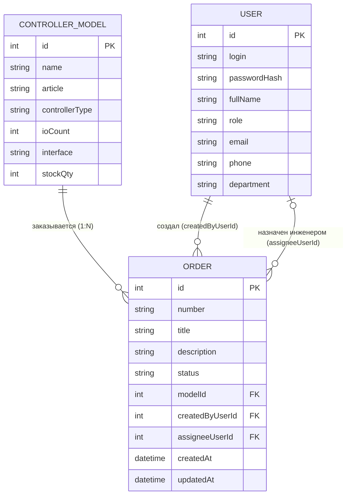

# Модель данных КонтрОрдер

Курс: Б1.В.ДЭ.01.02.02 · КГЭУ · семестр 1 · 2026/2027  
Студент: Абдуллина Айсылу Фанисовна · Группа: ТРИС-1-23  
Тема: Разработка системы учёта заказов контроллеров на предприятии (КонтрОрдер, АО «НИЦ «Инкомсистем»)

---

## 1. Словарь проекта

| Термин курса            | Термин моей темы                         |
| ----------------------- | ---------------------------------------- |
| Ticket (главный объект) | `Order` — заказ на контроллер            |
| Site (справочник)       | `ControllerModel` — модель контроллера   |
| User (пользователь)     | `User` — сотрудник производственного участка |

---

## 2. Сущности и атрибуты

### 2.1. Order (заказ на контроллер) — главный объект

| Поле              | Тип                           | Описание                                                        |
| ----------------- | ----------------------------- | --------------------------------------------------------------- |
| `id`              | int (PK)                      | Машинный первичный ключ (автоинкремент)                         |
| `number`          | string                        | Человеческий номер, например `ЗК-2026-0001`                     |
| `title`           | string (5–80)                 | Наименование заказа                                             |
| `description`     | string (10–500)               | Комплектация, количество, требования заказчика                  |
| `status`          | string                        | `New`, `InProgress`, `Closed`, `Cancelled`                      |
| `modelId`         | int (FK → ControllerModel)    | Ссылка на модель контроллера (справочник)                       |
| `createdByUserId` | int (FK → User)               | Кто создал заказ (менеджер)                                     |
| `assigneeUserId`  | int (FK → User, nullable)     | Назначенный инженер-наладчик; у нового заказа пусто             |
| `createdAt`       | datetime                      | Дата и время создания                                           |
| `updatedAt`       | datetime                      | Дата и время последнего изменения                               |

### 2.2. ControllerModel (модель контроллера) — справочник

| Поле             | Тип      | Описание                                        |
| ---------------- | -------- | ----------------------------------------------- |
| `id`             | int (PK) | Машинный первичный ключ                         |
| `name`           | string   | Наименование модели (например, ПЛК-110)         |
| `article`        | string   | Артикул / обозначение по конструкторской документации |
| `controllerType` | string   | Тип (ПЛК, модуль ввода-вывода и т. п.)          |
| `ioCount`        | int      | Количество каналов ввода-вывода                 |
| `interface`      | string   | Основной интерфейс связи (например, Modbus RTU) |
| `stockQty`       | int      | Количество готовых изделий на складе            |

Начальное наполнение справочника: 1 — ПЛК-110, 2 — ПЛК-120, 3 — МВ-8DI8DO, 4 — МВ-8AI, 5 — КСУ-300.

### 2.3. User (пользователь системы)

| Поле           | Тип             | Описание                                                          |
| -------------- | --------------- | ----------------------------------------------------------------- |
| `id`           | int (PK)        | Машинный первичный ключ                                           |
| `login`        | string (unique) | Логин для входа                                                   |
| `passwordHash` | string          | Хеш пароля (в открытом виде не хранится)                          |
| `fullName`     | string          | ФИО сотрудника                                                    |
| `role`         | string          | `Manager` (менеджер по заказам), `Chief` (начальник участка), `Engineer` (инженер-наладчик) |
| `email`        | string          | Электронная почта                                                 |
| `phone`        | string          | Телефон                                                           |
| `department`   | string          | Подразделение (участок)                                           |

---

## 3. ER-диаграмма

## 4. Связи между сущностями

- **ControllerModel → Order (1:N).** Одна модель может быть заказана много раз; каждый заказ относится ровно к одной модели.
- **User (создатель) → Order (1:N).** Один менеджер создаёт много заказов; у заказа один создатель.
- **User (исполнитель) → Order (0..1:N).** Один инженер может быть назначен на много заказов; у нового заказа исполнителя ещё нет (`assigneeUserId` пустой).

---

## 5. Проверка третьей нормальной формы (3НФ)

**Справочник `ControllerModel`.** Наименование, артикул, тип и интерфейс модели хранятся один раз в таблице `ControllerModels`. В таблице `Orders` лежит только числовой внешний ключ `modelId`, а не название модели текстом. Если модель переименуют или изменят её характеристики, правится одна строка справочника, а не все заказы. Если бы название хранилось текстом в каждом заказе, при переименовании пришлось бы править сотни строк, и данные могли бы разойтись (аномалия обновления).

**Пользователь `User`.** ФИО, роль и контакты сотрудника хранятся один раз в `Users`. В `Orders` лежат только `createdByUserId` и `assigneeUserId`. Если сотрудник сменит фамилию или уволится, меняется одна строка в `Users`.

Каждый неключевой атрибут таблицы зависит только от первичного ключа своей таблицы и ни от каких других неключевых атрибутов, значит модель находится в 3НФ.

---

## 6. Статусы и допустимые переходы

| Статус          | Код          | Описание                                           | Кто переводит                            |
| --------------- | ------------ | -------------------------------------------------- | ---------------------------------------- |
| Принят          | `New`        | Заказ создан, ожидает назначения исполнителя       | Система (при создании)                   |
| В производстве  | `InProgress` | Инженер собирает и настраивает контроллеры         | Назначенный инженер                      |
| Отгружен        | `Closed`     | Контроллеры отгружены заказчику                    | Назначенный инженер                      |
| Отменён         | `Cancelled`  | Заказ отменён (отказ заказчика, нет комплектующих) | Инженер своего заказа или начальник участка |

Допустимые переходы: `New` → `InProgress`; `InProgress` → `Closed`; `New` / `InProgress` → `Cancelled`. Из `Closed` и `Cancelled` переходов нет. Переход в `InProgress` разрешён только при назначенном исполнителе. Нарушение правил даёт `409 Conflict`.

Метод `DELETE` не используется: отмена заказа — это статус `Cancelled`, строка из базы не удаляется. Назначение исполнителя и смена статуса — два разных `PATCH`-запроса.

---

## 7. `id` и `number`

| Свойство           | `id`                           | `number`                                   |
| ------------------ | ------------------------------ | ------------------------------------------ |
| Тип                | целое число                    | строка                                     |
| Кто создаёт        | база данных (автоинкремент)    | сервер по шаблону `ЗК-ГГГГ-NNNN`           |
| Где используется   | в API: `/api/orders/17`        | для людей: «заказ ЗК-2026-0017»            |
| Можно ли менять    | нет                            | нет (формат номера может измениться регламентом, а связи по `id` останутся) |

Оба поля нужны: `id` удобен базе данных и API, `number` удобен менеджеру и инженеру, чтобы называть заказ вслух и находить его глазами в таблице.
