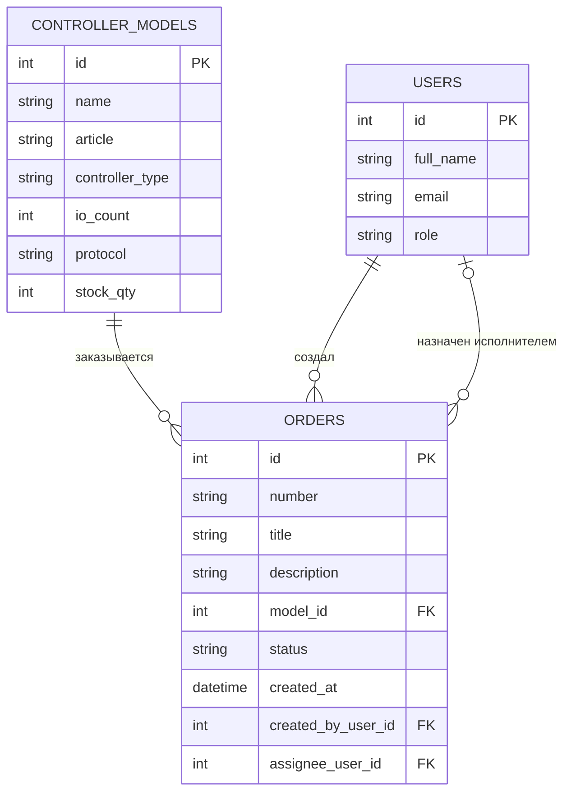

# Модель данных КонтрОрдер

Курс: Б1.В.ДЭ.01.02.02 · КГЭУ · семестр 1 · 2026/2027  
Студент: Абдуллина Айсылу Фанисовна · Группа: ТРИС-1-23  
Тема: Разработка системы учёта заказов контроллеров на предприятии (КонтрОрдер, АО «НИЦ «Инкомсистем»)

---

## 1. Состав модели

| Сущность          | Таблица PostgreSQL  | Назначение                                              |
| ----------------- | ------------------- | ------------------------------------------------------- |
| `Order`           | `orders`            | Главный объект: заказ на контроллер                     |
| `ControllerModel` | `controller_models` | Справочник моделей контроллеров                         |
| `User`            | `users`             | Сотрудники: менеджеры, начальники участка, инженеры     |

Имена таблиц и столбцов в базе записаны в `snake_case`, в C# и JSON — в `PascalCase` и `camelCase` соответственно.

---

## 2. Сущности и атрибуты

### 2.1. Order (заказ на контроллер)

| Поле API / C#     | Столбец             | Тип                          | Описание                                                    |
| ----------------- | ------------------- | ---------------------------- | ----------------------------------------------------------- |
| `id`              | `id`                | integer, PK                  | Машинный первичный ключ (автоинкремент)                     |
| `number`          | `number`            | text, unique                 | Человеческий номер, например `ЗК-2026-0001`                 |
| `title`           | `title`             | text, 5–80 символов          | Наименование заказа                                         |
| `description`     | `description`       | text, 10–500 символов        | Комплектация, количество, требования заказчика              |
| `modelId`         | `model_id`          | integer, FK → controller_models | Модель контроллера из справочника                        |
| `status`          | `status`            | text, по умолчанию `New`     | `New`, `InProgress`, `Closed`, `Cancelled`                  |
| `createdAt`       | `created_at`        | timestamptz                  | Дата и время создания                                       |
| `createdByUserId` | `created_by_user_id`| integer, FK → users          | Менеджер, создавший заказ                                   |
| `assigneeUserId`  | `assignee_user_id`  | integer, FK → users, nullable| Назначенный инженер-наладчик; у нового заказа не заполнен   |

### 2.2. ControllerModel (модель контроллера)

| Поле API / C#    | Столбец           | Тип                | Описание                                         |
| ---------------- | ----------------- | ------------------ | ------------------------------------------------ |
| `id`             | `id`              | integer, PK        | Машинный первичный ключ                          |
| `name`           | `name`            | text, unique       | Наименование модели (например, ПЛК-110)          |
| `article`        | `article`         | text, unique       | Артикул                                          |
| `controllerType` | `controller_type` | text               | Тип: ПЛК, модуль ввода-вывода и т. п.            |
| `ioCount`        | `io_count`        | integer            | Количество каналов ввода-вывода                  |
| `protocol`       | `protocol`        | text               | Протокол связи (например, Modbus RTU)            |
| `stockQty`       | `stock_qty`       | integer, по умолчанию 0 | Количество готовых изделий на складе        |

Начальное наполнение: 1 — ПЛК-110, 2 — ПЛК-120, 3 — МВ-8DI8DO, 4 — МВ-8AI, 5 — КСУ-300.

### 2.3. User (пользователь)

| Поле API / C# | Столбец     | Тип           | Описание                                                                 |
| ------------- | ----------- | ------------- | ------------------------------------------------------------------------ |
| `id`          | `id`        | integer, PK   | Машинный первичный ключ                                                  |
| `fullName`    | `full_name` | text          | ФИО сотрудника                                                           |
| `email`       | `email`     | text, unique  | Электронная почта                                                        |
| `role`        | `role`      | text          | `Manager` (менеджер по заказам), `Chief` (начальник участка), `Engineer` (инженер-наладчик) |

---

## 3. ER-диаграмма

## 4. Связи между сущностями

- **ControllerModel → Order (1:N).** Одна модель может быть заказана много раз; каждый заказ относится ровно к одной модели.
- **User (создатель) → Order (1:N).** Один менеджер создаёт много заказов; у заказа один создатель.
- **User (исполнитель) → Order (0..1:N).** Один инженер может быть назначен на много заказов; у нового заказа исполнителя ещё нет.

---

## 5. Проверка третьей нормальной формы (3НФ)

**Справочник `controller_models`.** Наименование, артикул, тип и протокол модели хранятся один раз в таблице `controller_models`. В таблице `orders` лежит только числовой внешний ключ `model_id`, а не название модели текстом. Если модель переименуют или изменят её характеристики, правится одна строка справочника, а не все заказы. Если бы название хранилось текстом в каждом заказе, при переименовании пришлось бы править много строк, и данные могли бы разойтись (аномалия обновления).

**Пользователи `users`.** ФИО, роль и почта сотрудника хранятся один раз. В `orders` лежат только `created_by_user_id` и `assignee_user_id`. Если сотрудник сменит фамилию, меняется одна строка в `users`.

Каждый неключевой атрибут таблицы зависит только от первичного ключа своей таблицы и ни от каких других неключевых атрибутов, значит модель находится в 3НФ.

---

## 6. Статусы и допустимые переходы

| Статус          | Код          | Описание                                           | Кто переводит                               |
| --------------- | ------------ | -------------------------------------------------- | ------------------------------------------- |
| Принят          | `New`        | Заказ создан, ожидает назначения исполнителя       | Система (при создании)                      |
| В производстве  | `InProgress` | Инженер собирает и настраивает контроллеры         | Назначенный инженер                         |
| Отгружен        | `Closed`     | Контроллеры отгружены заказчику                    | Назначенный инженер                         |
| Отменён         | `Cancelled`  | Заказ отменён (отказ заказчика, нет комплектующих) | Инженер своего заказа или начальник участка |

Допустимые переходы: `New` → `InProgress`; `InProgress` → `Closed`; `New` / `InProgress` → `Cancelled`. Из `Closed` и `Cancelled` переходов нет. Переход в `InProgress` разрешён только при назначенном исполнителе. Нарушение правил даёт `409 Conflict`.

Метод `DELETE` не используется: отмена заказа — это статус `Cancelled`, строка из базы не удаляется. Назначение исполнителя и смена статуса — два разных `PATCH`-запроса.

---

## 7. `id` и `number`

| Свойство         | `id`                        | `number`                                                                    |
| ---------------- | --------------------------- | --------------------------------------------------------------------------- |
| Тип              | целое число                 | строка                                                                      |
| Кто создаёт      | база данных (автоинкремент) | сервер по шаблону `ЗК-ГГГГ-NNNN`                                            |
| Где используется | в API: `/api/orders/17`     | для людей: «заказ ЗК-2026-0017»                                             |
| Можно ли менять  | нет                         | нет (формат может измениться регламентом, а связи по `id` останутся прежними) |

Оба поля нужны: `id` удобен базе данных и API, `number` удобен менеджеру и инженеру, чтобы называть заказ вслух и находить его глазами в таблице.
