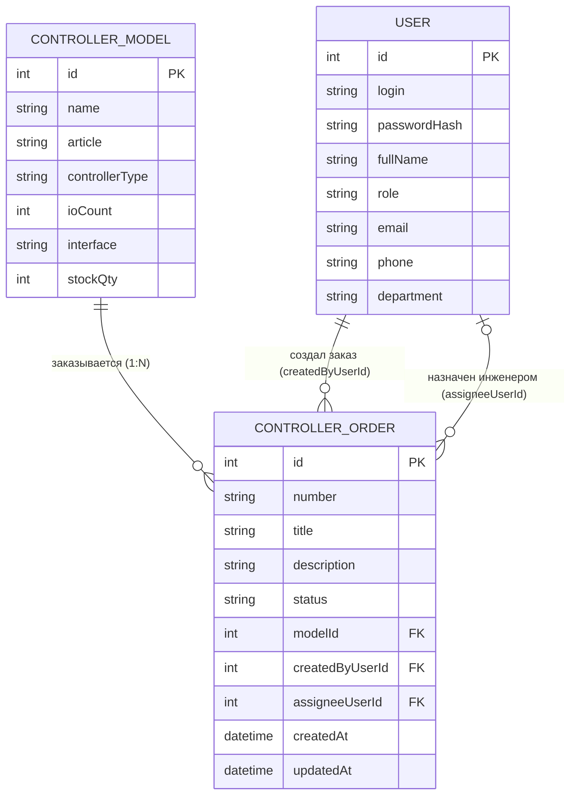

# Модель данных - АИС «КонтрОрдер»

## 1. Соответствие терминов

| Термин курса            | Термин моей темы                           |
| ----------------------- | ------------------------------------------ |
| Ticket (главный объект) | ControllerOrder (Заказ на контроллер)      |
| Site (справочник)       | ControllerModel (Модель контроллера)       |
| User (пользователь)     | User (Пользователь системы)                |

---

## 2. Сущности и их атрибуты

### 2.1. ControllerOrder (Заказ на контроллер)

**Главный объект процесса** - запись о заказе на изготовление и отгрузку контроллеров.

| Поле              | Тип                        | Описание                                                  |
| ----------------- | -------------------------- | --------------------------------------------------------- |
| `id`              | int (PK)                   | Машинный первичный ключ (автоинкремент)                   |
| `number`          | string                     | Человеческий номер заказа (например, ORD-2026-001)        |
| `title`           | string (5–80)              | Наименование заказа (заголовок)                           |
| `description`     | string (10–500)            | Комплектация, количество, требования заказчика            |
| `status`          | string                     | Статус заказа: `New`, `InProgress`, `Closed`, `Cancelled` |
| `modelId`         | int (FK -> ControllerModel)| Ссылка на модель контроллера (справочник)                 |
| `createdByUserId` | int (FK -> User)           | Кто создал заказ (менеджер)                               |
| `assigneeUserId`  | int (FK -> User, nullable) | Назначенный инженер-наладчик (может быть пустым при создании) |
| `createdAt`       | datetime                   | Дата и время создания заказа                              |
| `updatedAt`       | datetime                   | Дата и время последнего изменения                         |

### 2.2. ControllerModel (Модель контроллера)

**Справочник** - каталог моделей контроллеров, которые выпускает предприятие.

| Поле            | Тип      | Описание                                        |
| --------------- | -------- | ----------------------------------------------- |
| `id`            | int (PK) | Машинный первичный ключ                         |
| `name`          | string   | Наименование модели                             |
| `article`       | string   | Артикул / обозначение по КД                     |
| `controllerType`| string   | Тип (например, ПЛК, модуль ввода-вывода)        |
| `ioCount`       | int      | Количество каналов ввода-вывода                 |
| `interface`     | string   | Основной интерфейс связи (например, Modbus RTU) |
| `stockQty`      | int      | Количество готовых изделий на складе            |

### 2.3. User (Пользователь системы)

**Пользователи** - менеджеры по заказам, инженеры-наладчики, начальник участка.

| Поле           | Тип             | Описание                                                                                           |
| -------------- | --------------- | -------------------------------------------------------------------------------------------------- |
| `id`           | int (PK)        | Машинный первичный ключ                                                                            |
| `login`        | string (unique) | Логин для входа в систему                                                                          |
| `passwordHash` | string          | Хеш пароля (не хранится в открытом виде)                                                           |
| `fullName`     | string          | ФИО пользователя                                                                                   |
| `role`         | string          | Роль: `Manager` (менеджер по заказам), `Engineer` (инженер-наладчик), `Chief` (начальник участка)  |
| `email`        | string          | Email для уведомлений                                                                              |
| `phone`        | string          | Телефон                                                                                            |
| `department`   | string          | Подразделение (участок)                                                                            |

---

## 3. ER-диаграмма (Сущность–Связь)

## 4. Связи между сущностями (словами)

**ControllerModel -> ControllerOrder (1:N)**  
Одна модель контроллера может быть заказана много раз (в разных заказах).  
Один заказ относится к одной конкретной модели.

**User (создатель) -> ControllerOrder (1:N)**  
Один менеджер может создать много заказов.  
Один заказ создан одним менеджером.

**User (исполнитель) -> ControllerOrder (1:0..N)**  
Один инженер может быть назначен на много заказов.  
У нового заказа исполнителя может не быть (`assigneeUserId` nullable).  
Один заказ может быть назначен на одного инженера.

---

## 5. Проверка третьей нормальной формы (3НФ)

**Проверка для справочника ControllerModel:**
> Наименование модели (`name`), артикул, тип, интерфейс и другие атрибуты модели хранятся **только один раз** в таблице `ControllerModel`.
> В таблице `ControllerOrder` хранится **только внешний ключ** `modelId` (число), а не название модели текстом.
>
> **Почему это 3НФ:**
> Если мы захотим исправить обозначение модели или изменить её характеристики, нам нужно изменить **только одну строку** в таблице `ControllerModel`, а не десятки строк в `ControllerOrder`.
> Если бы мы хранили название модели текстом в каждом заказе, то при переименовании модели пришлось бы править все заказы, что привело бы к ошибкам и несогласованности данных.

**Проверка для пользователя User:**
> ФИО пользователя, его роль и контактные данные хранятся **только один раз** в таблице `User`.
> В таблице `ControllerOrder` хранятся **только внешние ключи** `createdByUserId` и `assigneeUserId` (числа), а не ФИО текстом.
>
> **Почему это 3НФ:**
> Если сотрудник сменит фамилию или уволится, нам нужно изменить **только одну строку** в таблице `User`, а не все заказы.

---

## 6. Статусы и переходы

| Статус        | Код          | Описание                                              | Кто может перевести                  |
| ------------- | ------------ | ----------------------------------------------------- | ------------------------------------ |
| Принят        | `New`        | Заказ создан, ожидает обработки                       | Система (при создании)               |
| В производстве| `InProgress` | Инженер собирает и настраивает контроллеры            | Назначенный инженер                  |
| Отгружен      | `Closed`     | Контроллеры отгружены заказчику                       | Назначенный инженер                  |
| Отменён       | `Cancelled`  | Заказ отменён (отказ заказчика, нет комплектующих)    | Инженер или начальник участка        |

Допустимые переходы: `New` → `InProgress`; `InProgress` → `Closed`; `New`/`InProgress` → `Cancelled`. Из `Closed` и `Cancelled` переходов нет.

**Важно:**

- Удаление заказов (`DELETE`) не используется. Отмена = статус `Cancelled`.
- Перевод из статуса в статус - отдельный `PATCH` запрос (не общий `UPDATE`).

---

## 7. Ключевые отличия `id` и `number`

| Поле                | `id`                        | `number`                                  |
| ------------------- | --------------------------- | ----------------------------------------- |
| **Тип**             | int (число)                 | string (строка)                           |
| **Кто генерирует**  | База данных (автоинкремент) | Сервер (по шаблону ORD-YYYY-NNN)          |
| **Уникальность**    | Гарантирована БД            | Гарантирована бизнес-логикой              |
| **Использование**   | В API: `/api/orders/17`     | Для человека: «Ваш заказ ORD-2026-042»    |
| **Можно ли менять** | Нет                         | Нет                                       |
| **Пример**          | `17`                        | `ORD-2026-042`                            |

**Почему оба поля нужны:**

- `id` - быстрый технический ключ для базы данных и API.
- `number` - удобный для человека (менеджер не запомнит `id=1742`, но запомнит `ORD-2026-042`).
